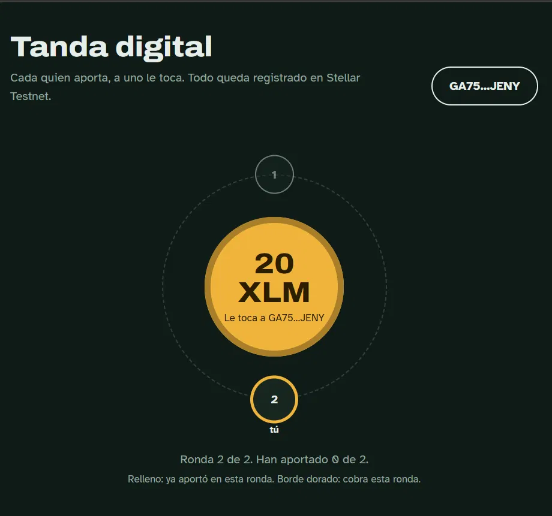
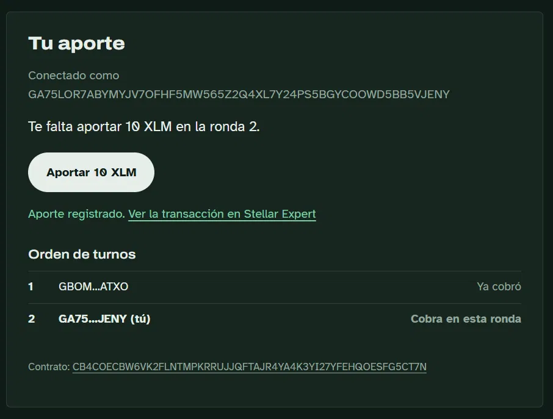
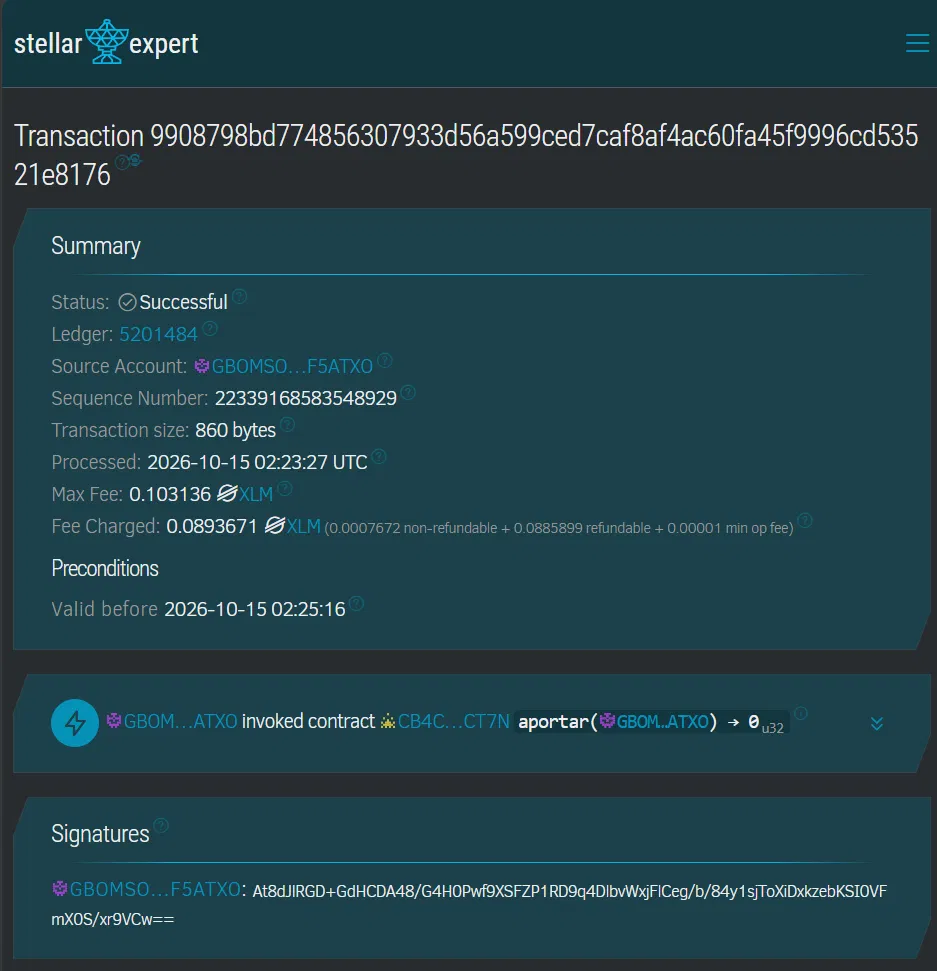
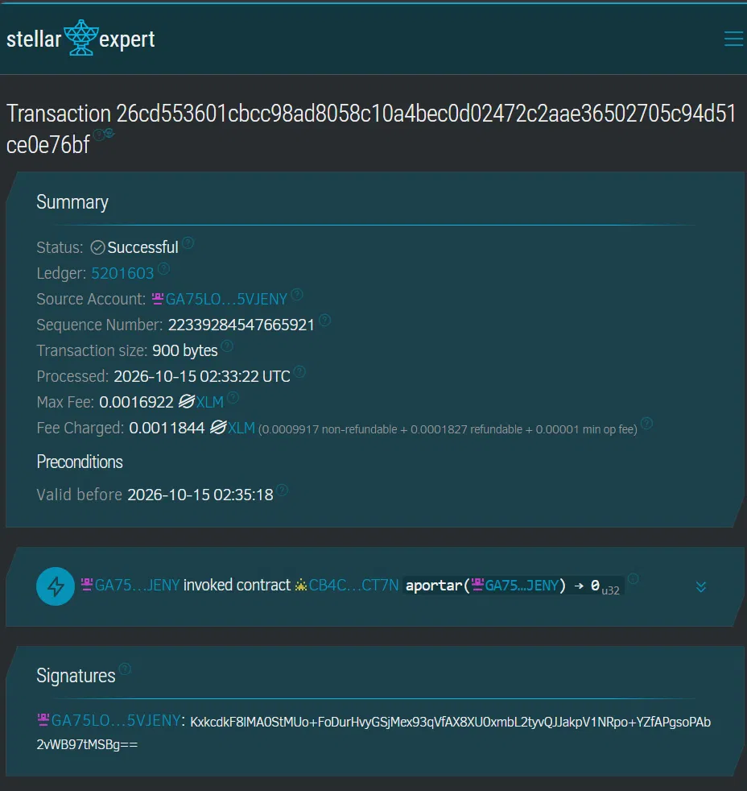

# Tanda digital en Stellar

Una tanda (ronda de ahorro) donde las reglas las cumple un contrato inteligente y no una persona. Cada ronda, todos los participantes aportan la misma cantidad de XLM; cuando aporta el último, el contrato le paga el bote completo a quien le toca y pasa a la siguiente ronda. Nadie puede saltarse su turno, aportar dos veces ni quedarse con el dinero, y cada movimiento queda registrado en Stellar Testnet.

Proyecto del bootcamp TESH (hackathon en Stellar Apex).

## Autora

**[Tu nombre completo]**, estudiante de [tu carrera] en el Tecnológico de Estudios Superiores de Huixquilucan (TESH).

Proyecto desarrollado de forma individual: diseño de la idea, contrato inteligente en Soroban, despliegue en Stellar Testnet, página con Freighter y pruebas de la tanda completa.

## El problema

La tanda es una forma de ahorro muy común en México: un grupo de personas aporta la misma cantidad cada periodo y, por turnos, a cada una le toca recibir el total. Funciona gracias a la confianza, y ahí está su punto débil. Alguien tiene que juntar el dinero y repartirlo; si esa persona se retrasa, se equivoca o desaparece con el bote, los demás pierden. Además, llevar la cuenta de quién ya pagó y a quién le toca suele depender de una libreta o un chat.

## La solución

En esta tanda digital, el que guarda el dinero y aplica las reglas es un contrato inteligente en Stellar, no una persona:

- **Nadie administra el dinero.** Los aportes van directo al contrato, y cuando todos aportaron, el contrato paga el bote al participante en turno de forma automática.
- **Las reglas no se pueden romper.** Solo los participantes registrados pueden aportar, nadie puede aportar dos veces en la misma ronda y el orden de turnos queda fijo desde el inicio.
- **Todo es verificable.** Cada aporte y cada pago queda registrado en la blockchain, y cualquiera puede revisarlo en Stellar Expert.
- **Es rápido y barato.** Cada transacción en Stellar se confirma en segundos y cuesta una fracción de centavo.

## Qué hay en el repositorio

`contracts/tanda` contiene el contrato en Soroban (Rust) con tres funciones: `inicializar` configura la tanda (participantes en orden de turno, monto del aporte y token), `aportar` registra el aporte de un participante y paga el bote automáticamente cuando todos aportaron, y `estado` devuelve todo lo que la pantalla necesita mostrar. También incluye pruebas unitarias.

`frontend` es una página hecha con Vite que se conecta con Freighter, muestra la rueda de turnos y permite aportar. Al aportar se genera la transacción on-chain y la página muestra el link de Stellar Expert.

## Tecnologías

- **Contrato:** Rust con Soroban SDK, desplegado en Stellar Testnet.
- **Página:** HTML, CSS y JavaScript con Vite, Stellar SDK y Freighter API.
- **Herramientas:** Stellar CLI para compilar, desplegar e inicializar el contrato; Stellar Expert para verificar las transacciones.

## Requisitos

Rust 1.91 o más reciente (instálalo con rustup), el target de WebAssembly (`rustup target add wasm32v1-none`), Stellar CLI (guía oficial: https://developers.stellar.org/docs/tools/cli/install-cli), Node.js 20 o más reciente, y la extensión Freighter en el navegador, configurada en **Testnet**.

## 1. Crear la cuenta que despliega

```bash
stellar keys generate omar --network testnet --fund
stellar keys address omar
```

## 2. Probar y compilar el contrato

```bash
cargo test
stellar contract build
```

El comando `build` imprime la ruta del archivo `.wasm`. Normalmente es `target/wasm32v1-none/release/tanda.wasm`.

## 3. Desplegar

```bash
stellar contract deploy \
  --wasm target/wasm32v1-none/release/tanda.wasm \
  --source omar \
  --network testnet \
  --alias tanda
```

Guarda la dirección que empieza con **C**. Es la que se entrega en APEX.

## 4. Configurar la tanda

Cada integrante del equipo abre Freighter en Testnet, fondea su cuenta con Friendbot y comparte su dirección (empieza con G). El orden en que las pongan es el orden de los turnos.

Primero obtén la dirección del contrato de XLM en testnet:

```bash
stellar contract id asset --asset native --network testnet
```

Luego inicializa la tanda. El aporte va en stroops: 1 XLM = 10,000,000, así que 10 XLM = 100000000.

```bash
stellar contract invoke --id tanda --source omar --network testnet -- \
  inicializar \
  --admin $(stellar keys address omar) \
  --token <DIRECCION_XLM> \
  --aporte 100000000 \
  --participantes '["GAAA...","GBBB...","GCCC..."]'
```

En PowerShell de Windows, sustituye `$(stellar keys address omar)` por la dirección G copiada directamente, y escribe la lista así: `--participantes '[\"GAAA...\",\"GBBB...\"]'`.

Para revisar que quedó bien:

```bash
stellar contract invoke --id tanda --source omar --network testnet -- estado
```

## 5. Correr la página

```bash
cd frontend
cp .env.example .env      # en Windows: copy .env.example .env
# edita .env y pega la dirección C en VITE_CONTRACT_ID
npm install
npm run dev
```

Abre la dirección que muestra la terminal, conecta Freighter con una cuenta participante y presiona **Aportar**. Al terminar aparece el link a Stellar Expert. Esa es la evidencia on-chain que se entrega.

## Entrega en APEX

Dirección del contrato: `CB4COECBW6VK2FLNTMPKRRUJJQFTAJR4YA4K3YI27YFEHQOESFG5CT7N`

Transacción invocada desde la página: `https://stellar.expert/explorer/testnet/tx/9908798bd774856307933d56a599ced7caf8af4ac60fa45f9996cd53521e8176`

Contrato en Stellar Expert: `https://stellar.expert/explorer/testnet/contract/CB4COECBW6VK2FLNTMPKRRUJJQFTAJR4YA4K3YI27YFEHQOESFG5CT7N`

## Demo: ronda 1 completa

La tanda se configuró con 2 participantes y un aporte de 10 XLM por ronda.

1. El participante 1 (`GBOM...ATXO`) aportó 10 XLM desde la página:
   https://stellar.expert/explorer/testnet/tx/9908798bd774856307933d56a599ced7caf8af4ac60fa45f9996cd53521e8176

2. El participante 2 (`GA75...JENY`) aportó 10 XLM desde la página. Como fue el último en aportar, en esa misma transacción el contrato pagó automáticamente el bote de 20 XLM al participante 1 y avanzó a la ronda 2:
   https://stellar.expert/explorer/testnet/tx/26cd553601cbcc98ad8058c10a4bec0d02472c2aae36502705c94d51ce0e76bf

En el segundo link se pueden ver los dos movimientos: el aporte que entra al contrato y el pago del bote que sale hacia el participante 1, sin que nadie tuviera que repartir el dinero a mano.

## Capturas

La página después de completar la ronda 1: el participante 1 ya cobró y ahora le toca al participante 2.





Primera aportación, invocada desde la página con Freighter:



Segunda aportación: el contrato recibe el aporte y paga el bote de 20 XLM al participante 1 en la misma transacción.



## Errores del contrato

| Código | Significado |
| --- | --- |
| 1 | La tanda ya estaba inicializada |
| 2 | El contrato no tiene tanda configurada |
| 3 | La cuenta no participa en la tanda |
| 4 | Ya aportó en esta ronda |
| 5 | La tanda terminó |
| 6 | Datos inválidos (aporte en cero, menos de 2 participantes o repetidos) |
